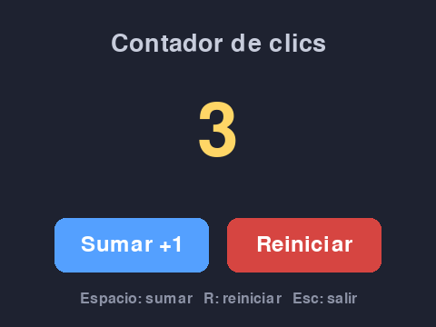

# Contador interactivo con Pygame

Taller de investigación: bibliotecas para interfaces gráficas en Python
Asignatura: Programación Orientada a Objetos

**Biblioteca investigada:** Pygame, en su edición comunitaria **pygame-ce**

**Ejemplo:** un contador que aumenta con un clic en un botón o con la barra espaciadora, y que se reinicia con otro botón o con la tecla R.



---

## 1. Investigación

### 1.1 ¿Qué es Pygame y cuál es su propósito?
Pygame es una biblioteca libre y de código abierto para Python, pensada para crear aplicaciones multimedia, principalmente videojuegos. Funciona sobre **SDL** (Simple DirectMedia Layer) y permite dibujar en una ventana, mostrar imágenes y texto, reproducir sonido y leer el teclado, el mouse y los controles de juego.

**pygame-ce** ("pygame Community Edition") es una bifurcación (*fork*) de Pygame creada por antiguos desarrolladores principales del proyecto. Su objetivo es publicar versiones con más frecuencia. Se importa igual (`import pygame`) y mantiene la misma API.

> **¿Por qué pygame-ce y no `pygame`?** La última versión del paquete `pygame` en PyPI es la 2.6.1 (septiembre de 2024) y no publica instaladores (*wheels*) para Python 3.14. pygame-ce 2.5.8 sí los tiene. Este proyecto se probó con Python 3.14.10, así que se usó pygame-ce. Con Python 3.13 o anterior el código también funciona con `pip install pygame`.

### 1.2 ¿Qué tipo de aplicaciones permite desarrollar?
- Videojuegos 2D (plataformas, arcade, puzles).
- Simulaciones y visualizaciones animadas.
- Aplicaciones interactivas y multimedia (sonido, imágenes, animación).
- Prototipos educativos que necesitan dibujar figuras y reaccionar al usuario en tiempo real.

No está pensada para formularios ni para aplicaciones de oficina: no incluye botones, cajas de texto ni menús ya hechos.

### 1.3 Instalación y requisitos
- **Requisitos:** Python 3.10 o superior (requisito de pygame-ce 2.5.8) y `pip`.
- **Instalación:**

```bash
pip install -r requirements.txt
```

o directamente:

```bash
pip install pygame-ce
```

- **Prueba de instalación** (abre un juego de ejemplo incluido en la biblioteca):

```bash
python -m pygame.examples.aliens
```

> No instales `pygame` y `pygame-ce` a la vez: ambos usan el nombre `pygame` y entran en conflicto.

### 1.4 Principales componentes
| Componente | Para qué sirve |
|---|---|
| `pygame.display` | Crea la ventana (`set_mode`), le pone título (`set_caption`) y muestra lo dibujado (`flip` / `update`). |
| `pygame.Surface` | Superficie de imagen sobre la que se dibuja. La ventana también es una `Surface`. |
| `pygame.Rect` | Rectángulo con posición y tamaño. Sirve para ubicar elementos y detectar colisiones (`collidepoint`). |
| `pygame.draw` | Dibuja figuras: rectángulos, círculos, líneas, polígonos. |
| `pygame.font` | Carga fuentes (`Font`, `SysFont`) y convierte texto en una `Surface` (`render`). |
| `pygame.image` | Carga y guarda imágenes (`load`, `save`). |
| `pygame.event` | Cola de eventos del usuario y del sistema. |
| `pygame.time.Clock` | Controla los cuadros por segundo del bucle. |
| `pygame.sprite` | Clases `Sprite` y `Group` para organizar objetos gráficos con POO. |
| `pygame.mixer` | Sonido y música. |

### 1.5 Manejo de eventos
Pygame guarda todo lo que hace el usuario (clics, teclas, movimiento del mouse, cerrar la ventana) en una **cola de eventos**. El programa la lee en cada vuelta de su **bucle principal** con `pygame.event.get()` y decide qué hacer según el tipo:

| Evento | Cuándo ocurre | Atributos útiles |
|---|---|---|
| `QUIT` | Se cierra la ventana | — |
| `MOUSEBUTTONDOWN` / `MOUSEBUTTONUP` | Se presiona o suelta un botón del mouse | `pos`, `button` (1 = izquierdo) |
| `MOUSEMOTION` | Se mueve el mouse | `pos`, `rel`, `buttons` |
| `KEYDOWN` / `KEYUP` | Se presiona o suelta una tecla | `key` (por ejemplo `pygame.K_SPACE`), `mod`, `unicode` |

A diferencia de Tkinter, **los eventos no se asocian a cada widget**. El programa recibe todos los eventos y debe averiguar a qué elemento corresponden; por ejemplo, para un clic se comprueba si `evento.pos` está dentro del `Rect` del botón con `rect.collidepoint(evento.pos)`.

```python
for evento in pygame.event.get():
    if evento.type == pygame.QUIT:
        ejecutando = False
    elif evento.type == pygame.MOUSEBUTTONDOWN and boton.collidepoint(evento.pos):
        contador += 1
```

### 1.6 Ventajas y limitaciones frente a Tkinter
| Aspecto | Pygame | Tkinter |
|---|---|---|
| Instalación | Hay que instalarlo con pip | Viene incluido con Python |
| Widgets listos (botones, entradas, menús) | No tiene: se construyen a mano | Sí los tiene |
| Control del dibujo | Total, píxel a píxel | Limitado (`Canvas`) |
| Animación y tiempo real | Pensado para eso (bucle + FPS) | Posible, pero no es su fuerte |
| Multimedia (sonido, sprites, controles de juego) | Incluido | No incluido |
| Eventos | Cola central que el programa revisa en su bucle | Se asocian a cada widget (`command`, `bind`) y Tkinter llama al callback |
| Redibujado | Manual: hay que redibujar cada cuadro | Automático al cambiar un widget |
| Distribución de elementos | Coordenadas manuales | Gestores `pack`, `grid`, `place` |
| Uso típico | Juegos, simulaciones, visualizaciones | Formularios y herramientas de escritorio |

**En resumen:** Pygame es mejor cuando se necesita animación o dibujo libre. Tkinter es más práctico para interfaces de formularios con controles estándar.

---

## 2. Ejemplo: contador interactivo

### 2.1 Estructura
```
contador_pygame/
├── main.py              # Punto de entrada
├── aplicacion.py        # Clase Aplicacion: ventana, bucle y eventos
├── boton.py             # Clase Boton: componente visual con callback
├── contador.py          # Clase Contador: estado (el número)
├── generar_captura.py   # Genera la captura de evidencia
├── requirements.txt     # pygame-ce>=2.5.8
├── capturas/
│   └── contador.png
└── README.md
```

### 2.2 Ejecución
Desde la carpeta del proyecto:

```bash
pip install -r requirements.txt
```

```bash
python main.py
```

**Controles:**
- Clic en **Sumar +1** o tecla **Espacio** → suma 1.
- Clic en **Reiniciar** o tecla **R** → vuelve a 0.
- **Esc** o cerrar la ventana → sale.

### 2.3 Explicación del funcionamiento

**1. Cómo se crea la ventana principal**
En `Aplicacion.__init__` (`aplicacion.py`) se inicializa Pygame, se crea la ventana de 480×360 y se le pone título:

```python
pygame.init()
self.pantalla = pygame.display.set_mode((ANCHO, ALTO))
pygame.display.set_caption("Contador interactivo - Pygame")
```

Después, `ejecutar()` mantiene la ventana abierta con un **bucle principal** que se repite 60 veces por segundo hasta que el usuario cierra la aplicación.

**2. Cómo se crean y muestran los componentes**
- El **texto** (título, número y ayuda) se convierte en imagen con `fuente.render(...)` y se pega en la ventana con `pantalla.blit(...)`.
- Los **botones** son objetos de la clase `Boton`. Cada uno tiene un `pygame.Rect`, un texto, colores y una acción, y se dibujan con `pygame.draw.rect`.
- Al final de cada cuadro, `pygame.display.flip()` muestra en pantalla todo lo dibujado.

**3. Eventos implementados y cómo se detectan**
En `procesar_eventos()` se leen los eventos con `pygame.event.get()`:

| Evento | Detección | Efecto |
|---|---|---|
| Clic izquierdo (`MOUSEBUTTONDOWN`, `button == 1`) | `Boton.manejar_evento` comprueba `self.rect.collidepoint(evento.pos)` | Ejecuta la acción del botón |
| Tecla (`KEYDOWN`) | `evento.key` se compara con `K_SPACE`, `K_r`, `K_ESCAPE` | Suma, reinicia o sale |
| Movimiento del mouse (`MOUSEMOTION`) | `collidepoint` sobre cada botón | El botón cambia de color (efecto *hover*) |
| Cerrar ventana (`QUIT`) | `evento.type == pygame.QUIT` | Termina el bucle |

**4. Funciones y métodos que responden al evento**
- `Boton.manejar_evento(evento)`: decide si el clic fue sobre el botón y, en ese caso, llama a su **callback**.
- Los callbacks son `Contador.incrementar` (botón *Sumar +1*) y `Contador.reiniciar` (botón *Reiniciar*), que se pasan al crear cada botón:

```python
Boton(60, 240, 170, 60, "Sumar +1", self.contador.incrementar, ...)
```

- `Aplicacion.al_presionar_tecla(tecla)` responde a las teclas.

**5. Cómo se modifica la interfaz después de la interacción**
El evento cambia el valor del `Contador`. En el mismo cuadro, `Aplicacion.dibujar()` limpia la ventana (`fill`), vuelve a dibujar todo leyendo `self.contador.valor` y llama a `flip()`. En Pygame la interfaz **no se actualiza sola**: se redibuja en cada vuelta del bucle con el estado actual.

```
Usuario hace clic → cola de eventos → pygame.event.get()
   → Boton.manejar_evento() → Contador.incrementar()
   → Aplicacion.dibujar() muestra el nuevo número → display.flip()
```

---

## 3. Reto adicional: POO con Pygame

Pygame **sí permite** construir la interfaz con clases y objetos. La propia biblioteca ofrece clases (`Surface`, `Rect`, `Clock`) y el módulo `pygame.sprite`, cuyas clases `Sprite` y `Group` están pensadas para heredar de ellas. Como no trae widgets, es habitual crear clases propias para los componentes, y este ejemplo lo hace así:

| Clase | Archivo | Responsabilidad |
|---|---|---|
| `Contador` | `contador.py` | Guarda el valor y sus reglas (`incrementar`, `reiniciar`). El valor está encapsulado en `_valor` y se lee con la propiedad `valor`, sin setter. No depende de Pygame. |
| `Boton` | `boton.py` | Componente visual reutilizable: se dibuja a sí mismo (`dibujar`), detecta si un evento le corresponde (`manejar_evento`) y ejecuta la acción que recibió al crearse. |
| `Aplicacion` | `aplicacion.py` | Coordina todo: crea la ventana, el contador y los botones, ejecuta el bucle principal, reparte los eventos y redibuja la pantalla. |

**Conceptos de POO aplicados:**
- **Encapsulamiento:** `Contador._valor` solo cambia mediante `incrementar()` y `reiniciar()`, y se expone con una propiedad de solo lectura.
- **Composición:** `Aplicacion` crea y contiene un `Contador` y una lista de `Boton`.
- **Callbacks / delegación:** cada `Boton` recibe la función que debe ejecutar, así que la misma clase sirve para botones con comportamientos distintos.
- **Separación de responsabilidades:** el estado (`Contador`) está separado de la presentación (`Boton`, `Aplicacion`).

---

## 4. Evidencia

`capturas/contador.png` muestra la aplicación con el contador en **3** y el botón *Sumar +1* resaltado por el *hover*.

La captura se generó con `python generar_captura.py`. Ese script crea la aplicación real, publica tres eventos `MOUSEBUTTONDOWN` sobre el botón con `pygame.event.post` (pasan por el mismo código que un clic real) y guarda la ventana con `pygame.image.save`.

Entorno de prueba: Windows, Python 3.14.10, pygame-ce 2.5.8 (SDL 2.32.10).

---

## 5. Fuentes consultadas
- Pygame en PyPI (versión, licencia LGPL, instalación): https://pypi.org/project/pygame/
- pygame-ce en PyPI (qué es el fork, versión 2.5.8, requisito Python ≥ 3.10): https://pypi.org/project/pygame-ce/
- Documentación oficial de Pygame, módulo `event`: https://www.pygame.org/docs/ref/event.html
- Documentación oficial de Pygame, módulo `display`: https://www.pygame.org/docs/ref/display.html
- Documentación oficial de Pygame, clase `Rect`: https://www.pygame.org/docs/ref/rect.html
- Documentación oficial de Pygame, módulo `font`: https://www.pygame.org/docs/ref/font.html
- Documentación oficial de Pygame, módulo `sprite`: https://www.pygame.org/docs/ref/sprite.html
- Documentación de Tkinter (para la comparación): https://docs.python.org/3/library/tkinter.html
